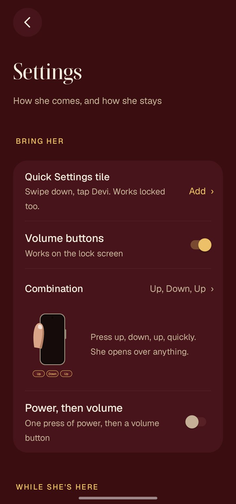
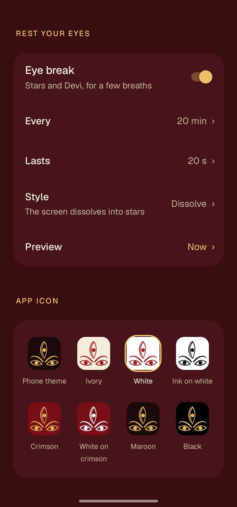

<p align="center">
  
</p>

<h1 align="center">Devi</h1>

<p align="center">
  A quiet Android app for Linga Bhairavi devotees.<br>
  Bring her onto your screen from anywhere, even the lock screen, and let her chant play on.
</p>

<p align="center">
  
  &nbsp;
  
</p>

## What it does

- **A full-screen feed of her.** Swipe up through your pictures of Devi and chant videos, endlessly. It stays silent until you tap play. Chants keep playing with the screen off.
- **Bring her from anywhere.** Open her over any app, or on the lock screen without unlocking:
  - a volume-button combination (Up, Down, Up, or nine others);
  - one press of power, then a volume button;
  - the Devi Quick Settings tile.
- **Focus while she's here.** The screen stays on, Do Not Disturb holds calls and notifications (alarms can ring through), and she stays as long as you choose.
- **Eye break.** Every so often, the night sky and Devi cover the screen for a few breaths so your eyes can rest. *(Work in progress.)*
- **Your library.** Add pictures, chant audio and videos from your phone or from a YouTube link.
- **Eight app icons**, from ivory to crimson to black.

## Payment-app safe

Android's Accessibility is what lets the volume buttons work on the lock screen, but payment apps like GPay refuse to run while any Accessibility service is on. Devi switches its Accessibility service on only while the phone is locked, and off the moment you unlock. It never reads what's on your screen.

This needs a one-time permission from a computer with USB or wireless debugging:

```bash
adb shell pm grant com.devi.overlay android.permission.WRITE_SECURE_SETTINGS
```

## Build

You need JDK 17 or newer and the Android SDK (compile SDK 36). The phone must run Android 12 (API 31) or newer.

```bash
./gradlew assembleDebug
```

```bash
./gradlew testDebugUnitTest
```

## Bring your own media

The chants, videos and pictures of Linga Bhairavi are the copyrighted work of the [Isha Foundation](https://isha.sadhguru.org/), so this repository doesn't include them. Add them from inside the app's Library, or bundle your own copies into the build:

| Folder under `app/src/main/assets/` | What goes in it |
|---|---|
| `bundled/` | Pictures, plus `order.txt` (one file name per line) and `main.txt` (the main picture's file name) |
| `bundled_chants/` | Audio files, plus `titles.txt` (`file<TAB>title` per line) |
| `bundled_videos/` | `.webm` or `.mp4` videos, plus `titles.txt` in the same format |

Official chants are on the [Sounds of Isha](https://www.youtube.com/@SoundsofIsha) YouTube channel.

## Credits

- Fonts: [Geist](https://vercel.com/font) (SIL Open Font License) and [Boska](https://www.fontshare.com/fonts/boska) (ITF Free Font License). Their licenses are in `app/src/main/assets/licenses/`.
- The chants, videos and imagery of Linga Bhairavi belong to the Isha Foundation.

## License

The Devi code is released under the [GNU General Public License v3.0](LICENSE).
